# Лабораторная работа № 1. Установка Debian на виртуальную машину и настройка SSH

## Цель работы

Установить гипервизор VirtualBox, создать виртуальную машину с Debian, настроить сетевые подключения (NAT и Bridged), обновить систему и настроить удалённый доступ к виртуальной машине по протоколу SSH (по паролю и по ключу).

## Используемые средства

| Компонент | Версия |
|---|---|
| Гипервизор | Oracle VirtualBox 7.2.16 |
| Гостевая ОС | Debian 13.7.0 «Trixie» (amd64, DVD-образ) |
| Хост-система | Windows, терминал Git Bash |

---

## 1. Установка виртуальной машины

### 1.1. Установка VirtualBox

Установщик VirtualBox скачан с официальной страницы загрузок [virtualbox.org](https://www.virtualbox.org/wiki/Downloads) (пакет для Windows hosts, версия 7.2.16).

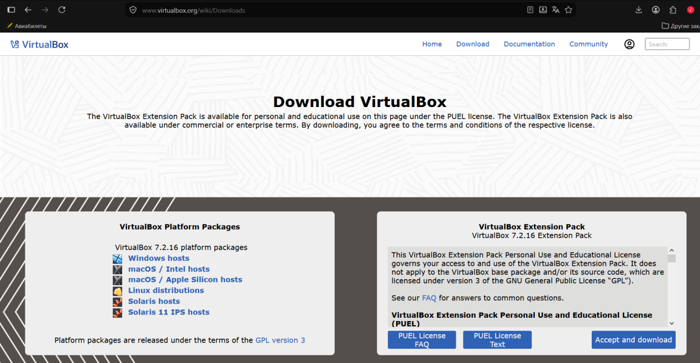

Далее запущен установщик и выполнена установка со стандартными параметрами.

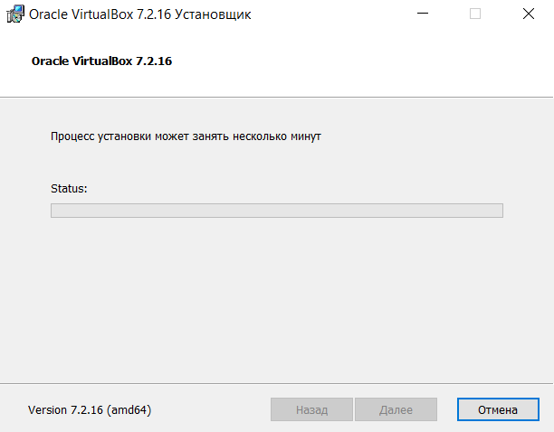

### 1.2. Создание виртуальной машины

В мастере создания ВМ указаны имя `Debian` и путь к скачанному ISO-образу `debian-13.7.0-amd64-DVD-1.iso`. VirtualBox автоматически определил тип ОС: Debian 13 Trixie (64-bit). Включена опция автоматической установки гостевой ОС.

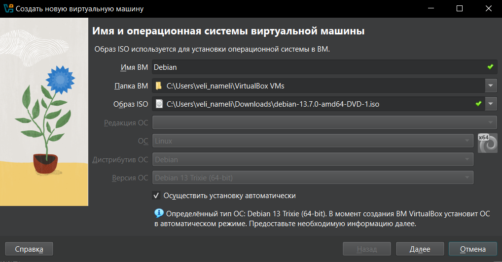

На следующем шаге заданы параметры автоматической установки: имя пользователя `vboxuser`, имя хоста `Debian`, домен `myguest.virtualbox.org`.

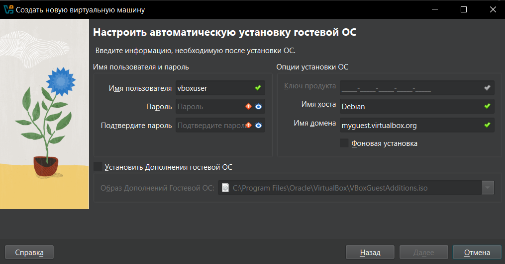

Виртуальному оборудованию выделены ресурсы согласно заданию:
- оперативная память: **4096 МБ**;
- процессор: **2 ЦПУ**;
- жёсткий диск: **30 ГБ**.

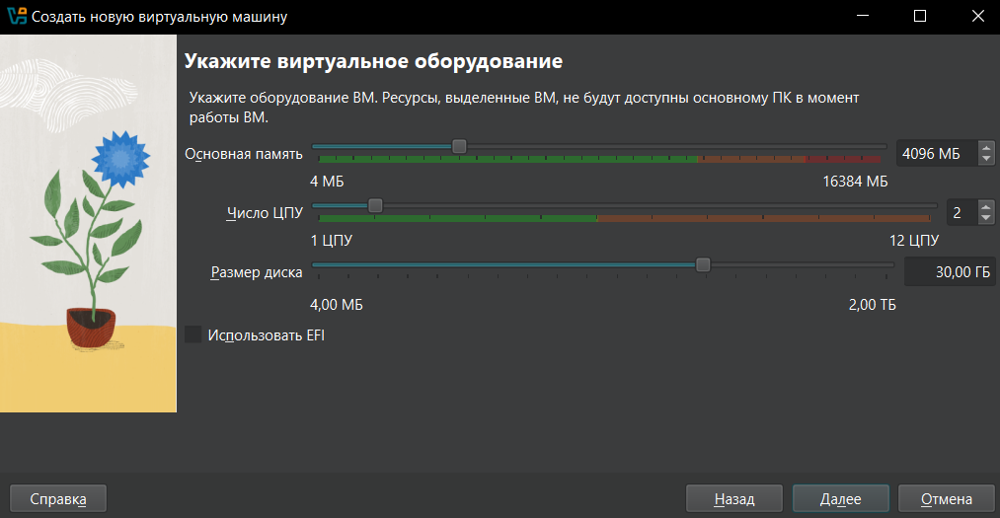

---

## 2. Установка Debian

После завершения автоматической установки виртуальная машина запустилась, и загрузился рабочий стол Debian (GNOME).

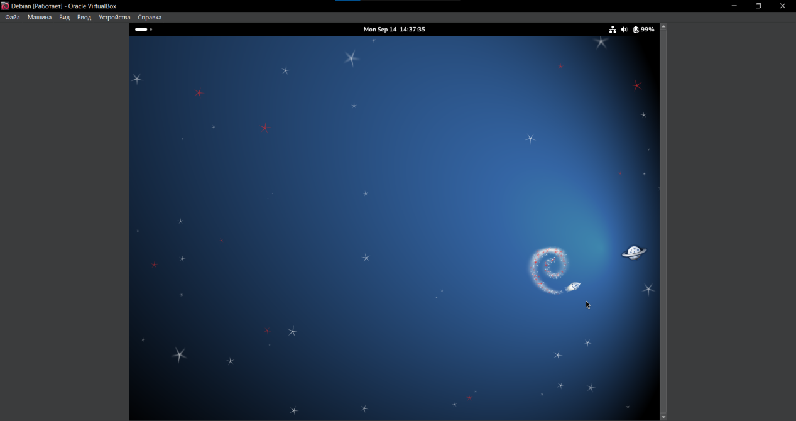

Проверка работоспособности системы: запущен браузер Firefox.

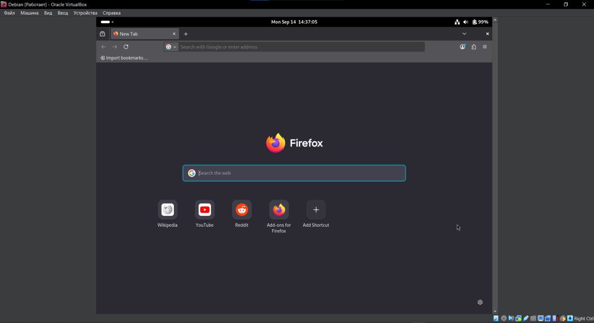

Основные параметры системы:

- имя компьютера: `Debian`;
- пользователь: `vboxuser`;

---

## 3. Настройка сети и обновление системы

### 3.1. Режим Bridged (сетевой мост)

Предпочтение отдано режиму NAT, так как используется WiFi

### 3.2. Режим NAT

Для адаптера 1 выбран тип подключения NAT. В этом режиме ВМ выходит в интернет через хост, но напрямую из внешней сети недоступна, поэтому для SSH-доступа настроен проброс портов (см. раздел 4).

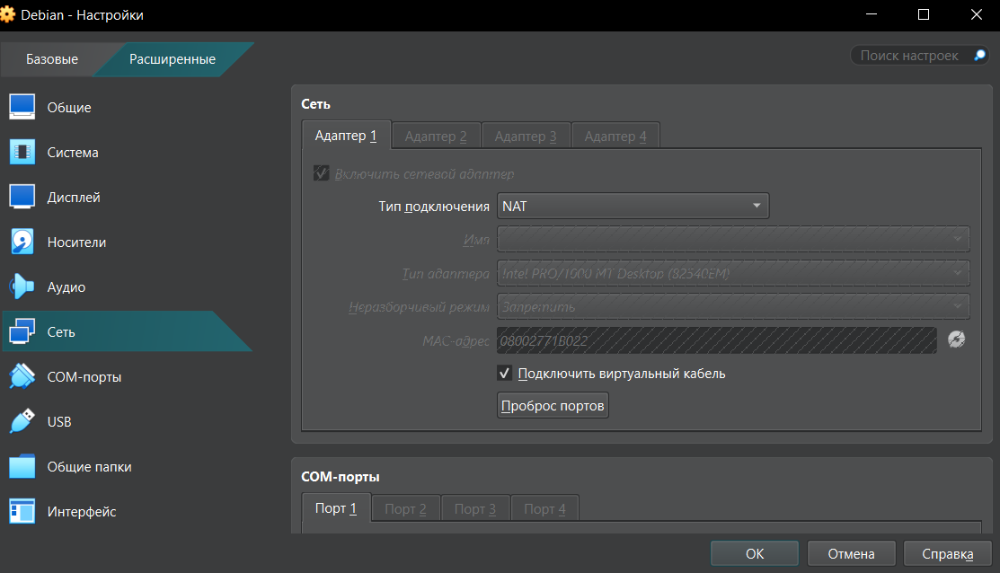

### 3.3. Обновление системы

Выполнены команды обновления списков пакетов и самих пакетов:

```bash
sudo apt-get update
sudo apt-get upgrade
```

При первом запуске `apt-get update` выдал ошибку по источнику `cdrom://`: APT пытался использовать установочный DVD как репозиторий. Остальные репозитории (`deb.debian.org`, `security.debian.org`) отработали штатно.

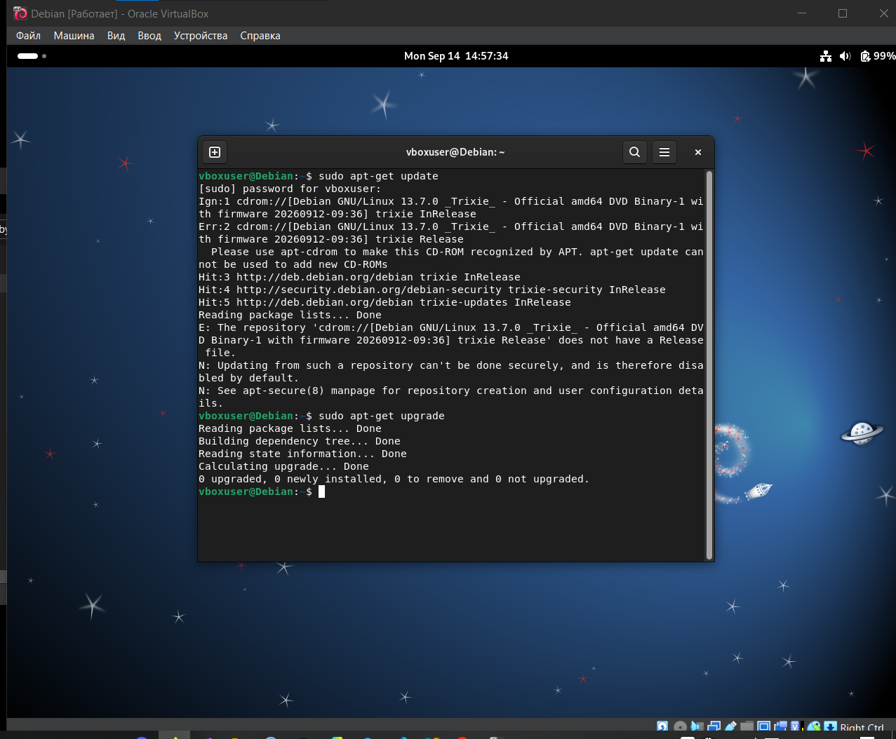

Чтобы убрать ошибку, файл со списком источников был отредактирован:

```bash
sudo nano /etc/apt/sources.list
sudo apt update
```

После правки `apt update` обращается только к сетевым репозиториям (`trixie`, `trixie-security`, `trixie-updates`) и сообщает, что доступно 73 пакета для обновления.

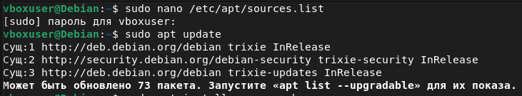

---

## 4. Настройка SSH

### 4.1. Установка SSH-сервера

Установлен пакет `openssh-server`:

```bash
sudo apt install -y openssh-server
```

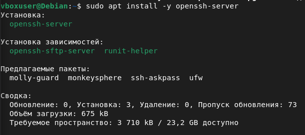

Служба включена в автозагрузку и сразу запущена:

```bash
sudo systemctl enable --now ssh
```

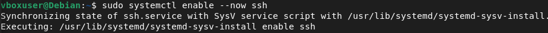

Проверка статуса: служба `ssh.service` имеет состояние `active (running)` и слушает порт 22.

```bash
sudo systemctl status ssh
```

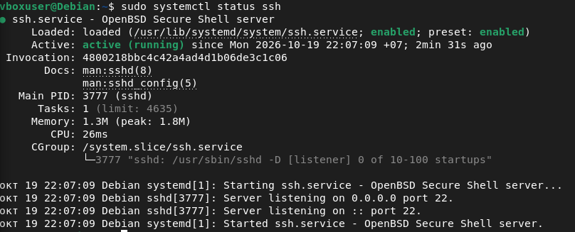

### 4.2. Проброс порта для режима NAT

Так как в режиме NAT ВМ недоступна напрямую, в настройках адаптера («Проброс портов») добавлено правило:

| Имя | Протокол | Порт хоста | Порт гостя |
|---|---|---|---|
| SSH | TCP | 2222 | 22 |

Теперь подключение к порту `2222` на `127.0.0.1` хоста перенаправляется на порт `22` виртуальной машины.

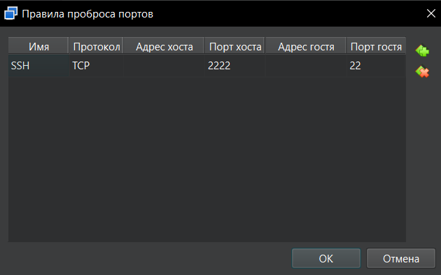

### 4.3. Подключение по паролю

С основного компьютера (Windows, Git Bash) выполнено подключение к виртуальной машине:

```bash
ssh -p 2222 vboxuser@127.0.0.1
```

После ввода пароля пользователя `vboxuser` вход выполнен успешно.

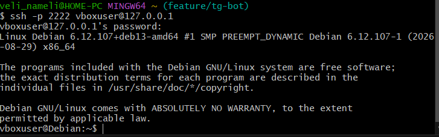

### 4.4. Подключение по ключу

Для входа без пароля использовалась пара ключей SSH (`id_ed25519`), созданная на основном компьютере командой:

```bash
ssh-keygen -t ed25519
```

Публичный ключ нужно передать в файл `~/.ssh/authorized_keys` на виртуальной машине. В Git Bash под Windows это сделано через конвейер (в тексте задания использована команда `type`, но в Git Bash вместо неё пишется `cat`):

```bash
cat ~/.ssh/id_ed25519.pub | ssh -p 2222 vboxuser@127.0.0.1 "mkdir -p ~/.ssh && chmod 700 ~/.ssh && cat >> ~/.ssh/authorized_keys && chmod 600 ~/.ssh/authorized_keys"
```

Команда создаёт каталог `~/.ssh` с правами `700`, дописывает публичный ключ в `authorized_keys` и выставляет на файл права `600`. Для копирования ключа пароль запрашивается в последний раз.

> Примечание: в Windows (PowerShell или cmd) вместо `cat` используется команда `type`: `type $env:USERPROFILE\.ssh\id_ed25519.pub | ssh ...`

После этого повторное подключение выполняется без ввода пароля:

```bash
ssh -p 2222 vboxuser@127.0.0.1
```

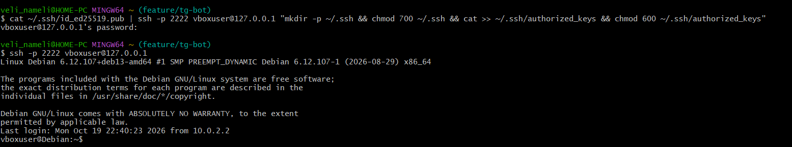

---

## Вывод

В ходе работы установлен VirtualBox 7.2.16, создана виртуальная машина (4 ГБ ОЗУ, 2 ЦПУ, диск 30 ГБ) и установлен Debian 13 «Trixie». Настроены два режима сети: NAT и сетевой мост. Выполнено обновление системы с помощью `apt-get update` и `apt-get upgrade`, устранена ошибка с источником `cdrom://`. Установлен и запущен SSH-сервер, настроен проброс порта 2222 → 22, а доступ с основного компьютера к виртуальной машине организован двумя способами: по паролю и по ключу SSH (без ввода пароля).
