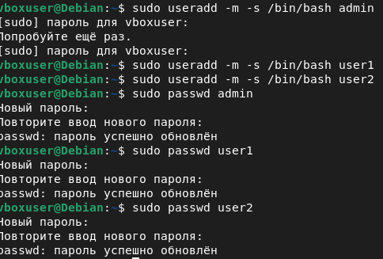
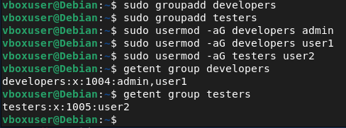
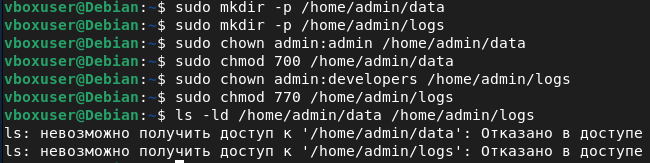
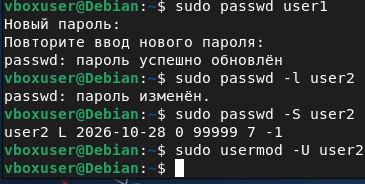
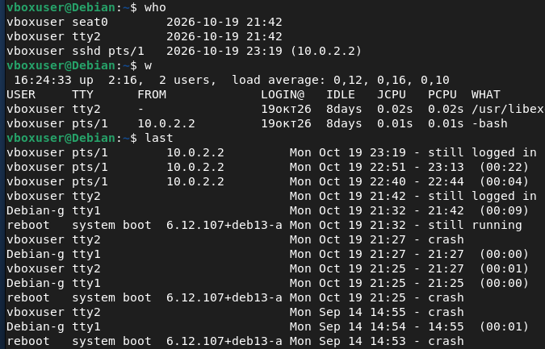
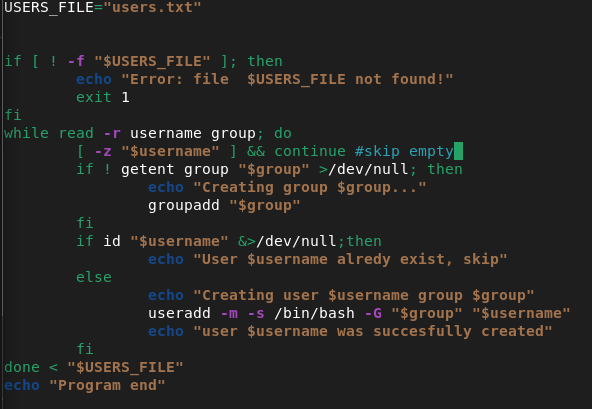
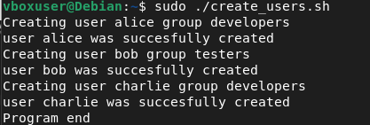

[Uploading README.md…]()

# Лабораторная работа №2. Управление системой и пользователями

**Выполнил:** *<ФИО, группа>*
**ОС:** Debian GNU/Linux 13 (ядро 6.12), Oracle VirtualBox
**Доступ к ВМ:** по SSH с основного ПК (настроено в лабораторной работе №1)

## Цель работы

Освоить базовые приёмы администрирования многопользовательской системы Linux: создание учётных записей и групп, управление членством в группах, настройку прав доступа к каталогам средствами `chmod` и `chown`, смену паролей и блокировку учётных записей, мониторинг активности пользователей, а также автоматизацию рутинных операций администрирования с помощью bash-скрипта.

---

## Задание 1. Создание пользователей и групп

### Создание пользователей

Пользователи создаются командой `useradd`. Использовались две опции: `-m` — создать домашний каталог в `/home/<имя>`, и `-s /bin/bash` — назначить командную оболочку bash. Без опции `-s` пользователь не сможет полноценно работать в терминале, так как получит упрощённую оболочку по умолчанию.

```bash
sudo useradd -m -s /bin/bash admin
sudo useradd -m -s /bin/bash user1
sudo useradd -m -s /bin/bash user2
```

Каждому пользователю задан пароль командой `passwd` (при вводе пароль на экране не отображается — это нормальное поведение):

```bash
sudo passwd admin
sudo passwd user1
sudo passwd user2
```



### Создание групп

```bash
sudo groupadd developers
sudo groupadd testers
```

### Добавление пользователей в группы

Для добавления в группы используется `usermod` с опцией `-aG`. Флаг `-a` (append) добавляет пользователя в дополнительную группу, **не удаляя** его из остальных групп; флаг `-G` задаёт список групп. Это важный нюанс: если указать только `-G`, пользователь будет исключён из всех прочих групп, кроме перечисленных, — типичная ошибка при работе с этой командой.

```bash
sudo usermod -aG developers admin
sudo usermod -aG developers user1
sudo usermod -aG testers user2
```

Проверка состава групп выполняется командой `getent group`: в группу `developers` (GID 1004) вошли `admin` и `user1`, в `testers` (GID 1005) — `user2`.



---

## Задание 2. Настройка прав доступа

### Создание каталогов и назначение прав

```bash
sudo mkdir -p /home/admin/data /home/admin/logs
sudo chown admin:admin     /home/admin/data
sudo chmod 700             /home/admin/data
sudo chown admin:developers /home/admin/logs
sudo chmod 770             /home/admin/logs
```



На скриншоте также виден дополнительный эффект защиты: пользователь `vboxuser` получает «Отказано в доступе» даже при попытке посмотреть атрибуты каталогов. Debian по умолчанию создаёт домашние каталоги с правами `750`, поэтому посторонние пользователи не могут даже войти в чужой домашний каталог — данные `admin` надёжно изолированы.

### Теория: чем отличаются chown и chmod

Команды решают две разные задачи и работают в паре:

- **`chown` (change owner)** — изменяет **владельца и группу-владельца** файла или каталога. Отвечает на вопрос: *кому* принадлежит объект. Права при этом не меняются — меняется только «хозяин».
- **`chmod` (change mode)** — изменяет **права доступа** к объекту. Отвечает на вопрос: *что* может делать с объектом владелец, группа и остальные пользователи (читать, записывать, выполнять).

Типичная схема администрирования: сначала `chown` назначает, *кто* владеет объектом, затем `chmod` определяет, *что* каждый может с ним делать. Одна команда не заменяет другую: можно быть владельцем без прав на запись, а можно иметь права без владения.

### Теория: что означает admin:admin

Синтаксис `пользователь:группа` в команде `chown`. В записи `admin:admin` первое `admin` — имя **пользователя-владельца**, второе `admin` — имя **группы-владельца** (при создании пользователя `useradd` автоматически создаёт и одноимённую группу). Группа-владелец может отличаться от пользователя: например, `admin:developers` означает «владелец — пользователь admin, группа-владелец — developers», именно так настроен каталог `logs`.

### Теория: что означают числа 700 и 770

Числовая запись прав — это три цифры, по одной для владельца, группы и остальных пользователей. Каждая цифра — сумма базовых разрешений: **4** = чтение (r), **2** = запись (w), **1** = выполнение (x).

| Цифра | Буквы | Что разрешено |
|:-----:|:-----:|---------------|
| 7 | `rwx` | чтение, запись, выполнение (всё) |
| 6 | `rw-` | чтение и запись |
| 5 | `r-x` | чтение и выполнение |
| 4 | `r--` | только чтение |
| 0 | `---` | нет доступа |

- **`700`** = `rwx------`: полный доступ есть **только у владельца** (admin), группа и остальные не имеют никаких прав. Подходит для приватного каталога `data`.
- **`770`** = `rwxrwx---`: полный доступ у **владельца и группы** (admin и developers), остальные отрезаны. Подходит для совместного каталога `logs`.

---

## Задание 3. Команды управления пользователями

### Изученные команды

| Команда | Назначение | Пример |
|---------|------------|--------|
| `useradd` | создание учётной записи пользователя | `sudo useradd -m -s /bin/bash user1` |
| `usermod` | изменение учётной записи (группы, пароль, оболочка, блокировка) | `sudo usermod -aG developers user1` |
| `groupadd` | создание группы | `sudo groupadd developers` |
| `passwd` | смена пароля (свой — без sudo, чужой — с sudo) | `sudo passwd user1` |
| `chown` | смена владельца и группы файла/каталога | `sudo chown admin:developers /home/admin/logs` |
| `chmod` | смена прав доступа (в числовой или буквенной записи) | `sudo chmod 770 /home/admin/logs` |

### Изменение пароля пользователя user1

```bash
sudo passwd user1
```

Система дважды запрашивает новый пароль и подтверждает: «пароль успешно обновлён».

### Блокировка учётной записи user2

Блокировка выполняется опцией `-L` (lock) команды `usermod` — в поле пароля в `/etc/shadow` добавляется символ `!`, делающий вход невозможным. Статус проверяется командой `passwd -S`, где буква `L` означает locked (заблокирован), `P` — пароль задан и активен.

```bash
sudo usermod -L user2
sudo passwd -S user2    # вывод: user2 L ... — учётная запись заблокирована
```

После проверки учётная запись была разблокирована обратной опцией `-U` (unlock):

```bash
sudo usermod -U user2
```



---

## Задание 4. Мониторинг активности пользователей

### Смысл команд

- **`who`** — показывает, кто находится в системе в данный момент: имя пользователя, терминал, время входа, а для удалённых сессий — IP-адрес подключения.
- **`w`** — расширенный вариант `who`: дополнительно выводит время работы системы (uptime), среднюю загрузку (load average), время бездействия (IDLE) и текущую выполняемую команду (WHAT) каждого пользователя.
- **`last`** — история всех входов в систему из журнала `/var/log/wtmp`: кто входил, когда, с какого адреса и как долго работал; также фиксирует перезагрузки и аварийные завершения.

### Анализ вывода

Команда `who` показала три активные сессии пользователя `vboxuser`: графическую (`seat0`), текстовую консоль (`tty2`) и **SSH-сессию (`sshd pts/1`) с адреса `10.0.2.2`** — это подключение с основного компьютера, настроенное в лабораторной работе №1. Команда `w` подтверждает: в системе 2 пользователя, uptime 2:16, load average близок к нулю, в колонке WHAT видна запущенная оболочка `-bash`.

Команда `last` вывела историю входов: активные сессии помечены `still logged in`, зафиксированы перезагрузки (`reboot system boot`) и аварийные завершения (`crash`) — записи позволяют администратору отследить, кто и когда работал в системе, даже после её перезапуска. Полезные варианты: `last user1` — входы конкретного пользователя, `last reboot` — история перезагрузок.



---

## Задание 5. Автоматизация управления пользователями

### Файл со списком пользователей (users.txt)

Скрипт читает текстовый файл, где каждая строка — пара «логин группа»:

```
alice developers
bob testers
charlie developers
```

### Скрипт create_users.sh

```bash
#!/bin/bash
# Массовое создание пользователей и групп из файла users.txt
# Формат строки: <логин> <группа>

USERS_FILE="users.txt"

if [ ! -f "$USERS_FILE" ]; then
    echo "Error: file $USERS_FILE not found!"
    exit 1
fi

while read -r username group; do
    [ -z "$username" ] && continue          # пропуск пустых строк

    # создать группу, если её ещё нет
    if ! getent group "$group" >/dev/null; then
        echo "Creating group $group..."
        groupadd "$group"
    fi

    # создать пользователя, если его ещё нет
    if id "$username" >/dev/null 2>&1; then
        echo "User $username already exists, skip"
    else
        echo "Creating user $username (group $group)..."
        useradd -m -s /bin/bash -G "$group" "$username"
        echo "User $username was successfully created"
    fi
done < "$USERS_FILE"

echo "Program end"
```

### Как работает скрипт

- `while read -r username group` — построчно читает `users.txt`, разбивая каждую строку на две переменные: логин и имя группы.
- `[ -z "$username" ] && continue` — пропускает пустые строки файла.
- `getent group` проверяет существование группы, `id` — существование пользователя. Благодаря этим проверкам скрипт **идемпотентен**: его можно запускать повторно — уже существующие учётные записи будут пропущены без ошибок и дублирования.
- `useradd -m -s /bin/bash -G "$group"` — создаёт пользователя с домашним каталогом, оболочкой bash и сразу добавляет его в нужную группу.
- Перенаправления `>/dev/null 2>&1` скрывают служебный вывод проверочных команд, чтобы не засорять отчёт скрипта.

При отладке скрипта были учтены особенности синтаксиса bash: при присваивании переменной (`USERS_FILE="users.txt"`) пробелы вокруг знака `=` не допускаются, опции команд начинаются с дефиса (`-G`, а не `/G`), а первая строка скрипта должна быть `#!/bin/bash` — без неё скрипт исполняет не та оболочка (в Debian `/bin/sh` — это dash, не понимающий bash-синтаксис), из-за чего логика проверок ломается.

### Запуск и проверка

```bash
chmod +x create_users.sh   # делаем скрипт исполняемым
sudo ./create_users.sh     # запуск (создание пользователей требует root)
```

В результате выполнения созданы пользователи `alice` и `charlie` (группа developers) и `bob` (группа testers). Повторный запуск скрипта выводит сообщения о пропуске существующих пользователей, не создавая дубликатов.





---

## Выводы

В ходе лабораторной работы освоен базовый цикл администрирования пользователей в Linux: создание учётных записей и групп (`useradd`, `groupadd`), управление членством в группах (`usermod -aG`), настройка прав доступа к каталогам с пониманием различий между сменой владельца (`chown`) и сменой прав (`chmod`) и с числовой записью прав (`700` — только владелец, `770` — владелец и группа). Отработаны смена пароля (`passwd`) и блокировка учётной записи (`usermod -L/-U` с контролем статуса через `passwd -S`). Изучены средства мониторинга активности (`who`, `w`, `last`), позволяющие видеть активные сессии в реальном времени и историю входов, включая сессии, установленные по SSH из лабораторной работы №1. Автоматизация массового создания пользователей bash-скриптом показала типовой приём идемпотентной автоматизации: скрипт безопасно выполнять повторно, проверки `id` и `getent` защищают от дублирования учётных записей.
