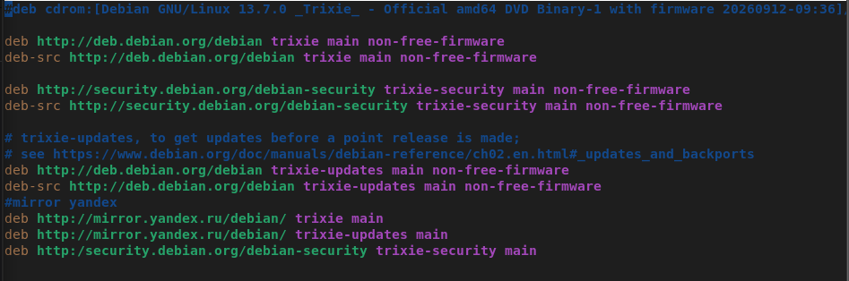
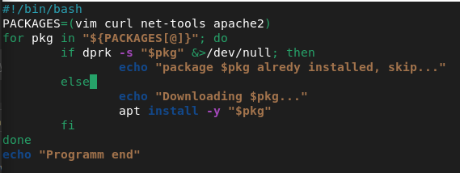
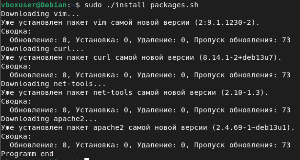
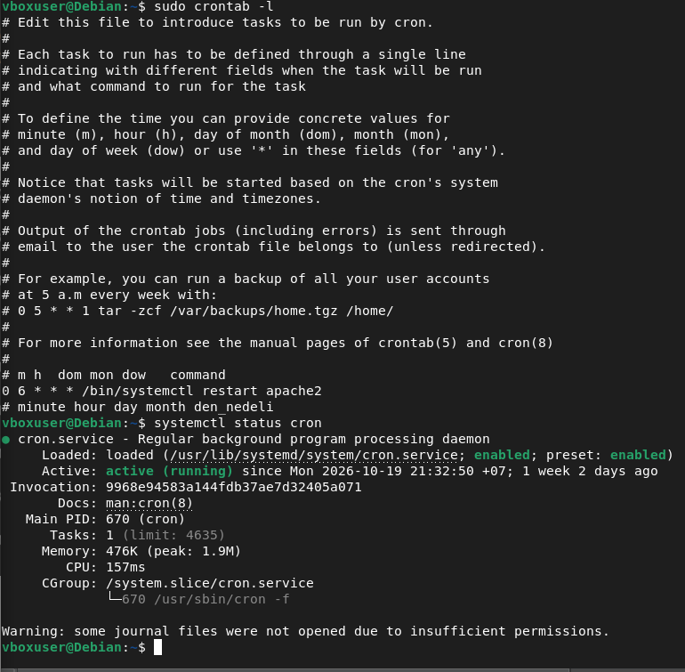
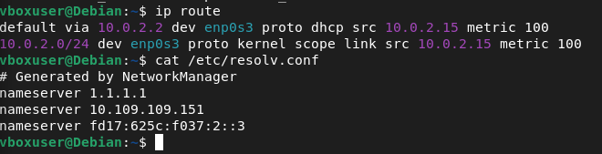
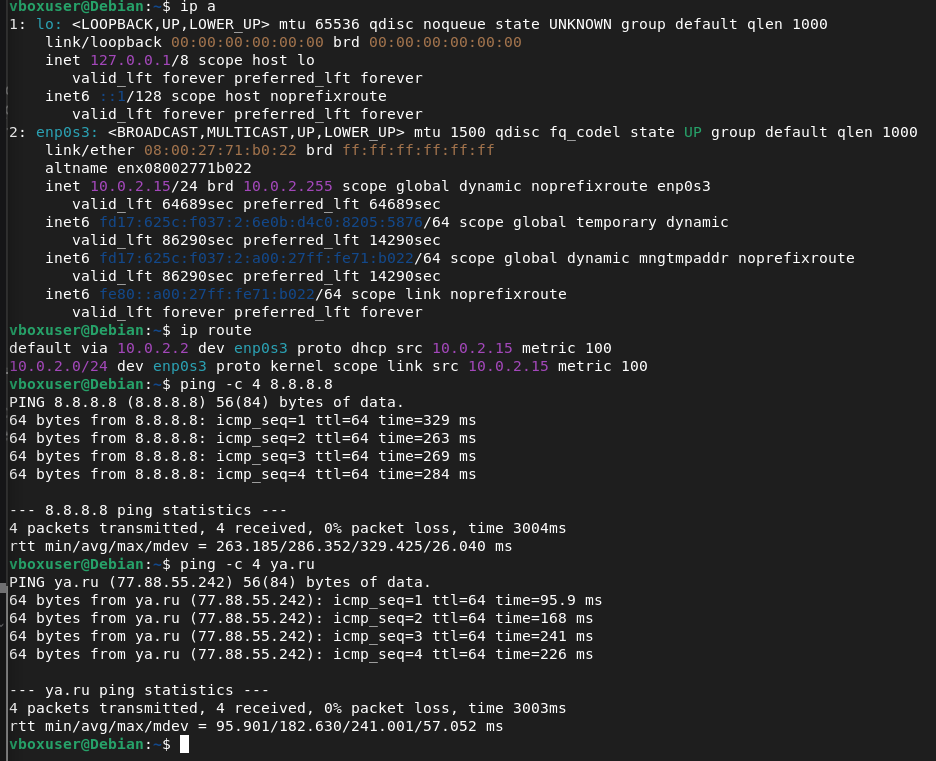
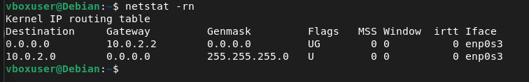
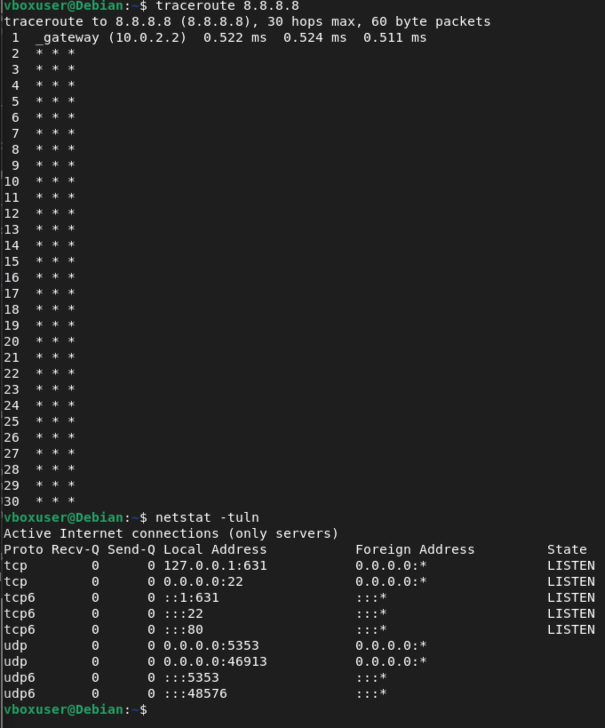
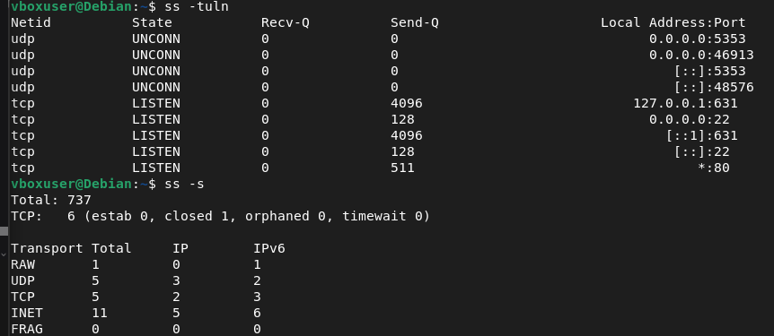

[README.md](https://github.com/user-attachments/files/34087129/README.md)
# Лабораторная работа №3. Управление пакетами, системными сервисами и настройка сети


**Выполнил:** *<ФИО, группа>*
**ОС:** Debian GNU/Linux 13 (Oracle VirtualBox), доступ по SSH с основного ПК (лабораторная работа №1)

---

## Задание 1. Управление пакетами

### Настройка источников пакетов

В файле `/etc/apt/sources.list` оставлены официальные репозитории Debian и добавлено зеркало Яндекса:

```
# Официальные репозитории
deb http://deb.debian.org/debian/ trixie main non-free-firmware
deb http://security.debian.org/debian-security trixie-security main non-free-firmware
deb http://deb.debian.org/debian/ trixie-updates main non-free-firmware

# Зеркало (Яндекс)
deb http://mirror.yandex.ru/debian/ trixie main
deb http://mirror.yandex.ru/debian/ trixie-updates main
deb http://security.debian.org/debian-security trixie-security main
```

Строки `deb` подключают бинарные пакеты, `deb-src` — исходники. Зеркало дублирует официальные репозитории и ускоряет загрузку пакетов за счёт близкого расположения серверов. После правки файла индексы пакетов обновлены командой `sudo apt update`.



### Скрипт установки пакетов

Скрипт `install_packages.sh` устанавливает требуемый набор пакетов: список хранится в массиве `PACKAGES`, в цикле `for` для каждого пакета командой `dpkg -s` проверяется, установлен ли он уже (это делает скрипт безопасным при повторном запуске), и при отсутствии выполняется `apt install -y`:

```bash
#!/bin/bash
# Скрипт установки набора пакетов

PACKAGES=(vim curl net-tools apache2)

for pkg in "${PACKAGES[@]}"; do
    if dpkg -s "$pkg" &>/dev/null; then
        echo "Package $pkg already installed, skip..."
    else
        echo "Downloading $pkg..."
        apt install -y "$pkg"
    fi
done

echo "Program end"
```

Запуск:

```bash
chmod +x install_packages.sh
sudo ./install_packages.sh
```





Скрипт поочерёдно обрабатывает каждый пакет, и `apt` выводит итог: все четыре пакета установлены и имеют последнюю версию. Повторный запуск скрипта ничего не ломает — уже установленные пакеты пропускаются.

---

## Задание 2. Работа с системными сервисами

### Автозапуск Apache и SSH

```bash
sudo systemctl enable apache2
sudo systemctl enable ssh
systemctl is-enabled apache2 ssh
```

Команда `enable` включает автозапуск сервиса при загрузке системы (создаёт ссылки в каталоге автозапуска systemd). Проверка `is-enabled` возвращает `enabled` для обоих сервисов.

### Ежедневный перезапуск Apache через cron

В crontab суперпользователя (`sudo crontab -e`) добавлена строка:

```
0 6 * * * /bin/systemctl restart apache2
```

Поля cron: `минута час день_месяца месяц день_недели` — то есть перезапуск выполняется ежедневно в 06:00. Служба планировщика проверена командой `systemctl status cron`: активна (`active (running)`) и включена в автозапуск (`enabled`).



---

## Задание 3. Конфигурация сети

### Параметры до настройки

Текущая конфигурация: шлюз по умолчанию `10.0.2.2` (шлюз NAT VirtualBox), адрес получен по DHCP, DNS-серверы — в `/etc/resolv.conf`:



### Статический IP в /etc/network/interfaces

```bash
sudo nano /etc/network/interfaces
```

```
auto enp0s3
iface enp0s3 inet static
    address 10.0.2.15/24
    gateway 10.0.2.2
```

`auto` — поднимать интерфейс при загрузке, `address` — статический IP, `gateway` — шлюз. DNS заданы в `/etc/resolv.conf` (`nameserver 8.8.8.8`, `nameserver 1.1.1.1`). После сохранения конфигурация применена перезапуском сетевой службы (`sudo systemctl restart networking`).

### Проверка

Конфигурация проверена командами `ip a` (адрес интерфейса `enp0s3` — 10.0.2.15/24) и `ip route` (маршрут по умолчанию через 10.0.2.2). Доступность внешней сети подтверждена пингами: `ping 8.8.8.8` (по IP) и `ping ya.ru` (по имени — заодно проверяется работа DNS). В обоих случаях 4 пакета из 4, потери 0%.



---

## Задание 4. Диагностика сетевых проблем

### netstat — соединения, порты, маршруты

`netstat` (из пакета net-tools) показывает сетевые соединения, слушаемые порты и таблицы маршрутизации. Полезные опции: `-r` — таблица маршрутизации, `-t/-u` — TCP/UDP, `-l` — только слушающие сокеты, `-n` — числами (без резолвинга имён), `-p` — имя процесса.

`netstat -rn` вывел таблицу маршрутизации: маршрут по умолчанию (`0.0.0.0/0`, флаг `UG`) через шлюз 10.0.2.2 и локальную сеть 10.0.2.0/24:



### traceroute — маршрут пакетов до цели

`traceroute 8.8.8.8` показывает путь пакета по хопам. Первый хоп — шлюз 10.0.2.2 (0.5 мс). Дальнейшие хопы отображаются `* * *`: NAT-движок VirtualBox не передаёт ICMP-сообщения «Time Exceeded» от промежуточных маршрутизаторов, поэтому за шлюзом маршрут не виден — это особенность виртуального NAT, а не проблема сети (связность подтверждена пингами в задании 3).

`netstat -tuln` показывает слушаемые порты: `22` — SSH-сервер, `631` — CUPS (печать), `80` — Apache.



### ss — современная замена netstat

`ss` выводит те же данные, что и `netstat`, но принципиально быстрее: `netstat` читает таблицу сокетов из виртуальных файлов `/proc/net/tcp` и `/proc/net/udp` построчно, что медленно и плохо масштабируется на системах с большим числом соединений (к тому же net-tools давно не развивается). `ss` получает сведения напрямую от ядра через netlink-сокет — моментально и с линейным ростом времени при увеличении числа соединений. Дополнительно `ss` поддерживает фильтры (например, `ss -tuln sport = :80`) и сводку состояний `ss -s`.

На скриншоте: `ss -tuln` — слушаемые порты (22, 631, 80); `ss -s` — сводка: всего 737 сокетов, TCP — 6 соединений.



---

## Выводы

В ходе лабораторной работы настроены источники пакетов (официальные репозитории Debian и зеркало Яндекса), установка набора пакетов автоматизирована идемпотентным bash-скриптом; командами `systemctl` включён автозапуск Apache и SSH, через cron настроен ежедневный перезапуск Apache; изучена конфигурация сети (`/etc/network/interfaces`, `/etc/resolv.conf`) и выполнена проверка средствами `ip`, `ifconfig`, `ping`; для диагностики использованы `traceroute`, `netstat` и современный `ss`.

Типовой сценарий диагностики: сайт не открывается → `systemctl status apache2` (сервис жив?) → `ss -tuln | grep :80` (порт слушается?) → `ping` / `traceroute` (сеть доступна?) — так последовательно определяется уровень проблемы: сервис, порт или сеть.

