# Лабораторная работа №4. Безопасность системы и файловые системы

| | |
|---|---|
| **Студент** | _ФИО, группа_ |
| **ОС** | Debian GNU/Linux 13 (trixie) |
| **Среда** | VirtualBox, пользователь `vboxuser` |
| **Цель** | Настроить файрвол, защиту от брутфорса и автообновления, подключить и смонтировать новый диск, организовать мониторинг свободного места |

## Содержание

1. [Настройка файрвола (UFW)](#1-настройка-файрвола-ufw)
2. [Безопасность системы](#2-безопасность-системы)
3. [Управление файловыми системами](#3-управление-файловыми-системами)
4. [Мониторинг дискового пространства](#4-мониторинг-дискового-пространства)
5. [Вывод](#5-вывод)

---

## Подготовка

Проверка системы и пользователя, под которым выполняется работа.

| Команда | Что делает |
|---|---|
| `hostname` | выводит имя компьютера |
| `whoami` | выводит имя текущего пользователя |
| `lsb_release -a` | показывает дистрибутив и версию ОС |

```bash
hostname && whoami && lsb_release -a
```

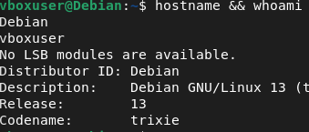

---

## 1. Настройка файрвола (UFW)

**Теория.** Файрвол (межсетевой экран) фильтрует сетевой трафик по правилам. **UFW** (Uncomplicated Firewall) — упрощённая надстройка над `iptables`/`nftables`: администратор пишет короткие команды, а UFW сам создаёт низкоуровневые правила. Принцип безопасной настройки: **запретить всё входящее по умолчанию и разрешить только нужное**. Для каждого правила UFW автоматически добавляет и IPv4, и IPv6 вариант.

| Команда | Что делает |
|---|---|
| `apt install ufw` | устанавливает UFW |
| `ufw status` | показывает состояние файрвола (`active` / `inactive`) |
| `ufw default deny incoming` | политика по умолчанию: блокировать всё входящее |
| `ufw default allow outgoing` | политика по умолчанию: разрешить всё исходящее |
| `ufw allow ssh` | разрешить порт 22/tcp (удалённый доступ) |
| `ufw allow http` | разрешить порт 80/tcp (веб без шифрования) |
| `ufw allow https` | разрешить порт 443/tcp (веб с шифрованием) |
| `ufw enable` | включить файрвол и добавить его в автозагрузку |
| `ufw status verbose` | статус с политиками по умолчанию и логированием |
| `ufw status numbered` | правила с номерами (удобно для удаления) |
| `iptables -L -n -v` | `-L` список правил, `-n` без разрешения имён (быстрее), `-v` со счётчиками пакетов |

> SSH разрешается **до** `ufw enable`, иначе можно потерять удалённый доступ.

### 1.1 Установка UFW

```bash
sudo apt install -y ufw
sudo ufw status
```

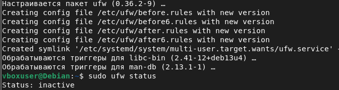

### 1.2 Политики и правила

```bash
sudo ufw default deny incoming
sudo ufw default allow outgoing
sudo ufw allow ssh
sudo ufw allow http
sudo ufw allow https
sudo ufw enable
```

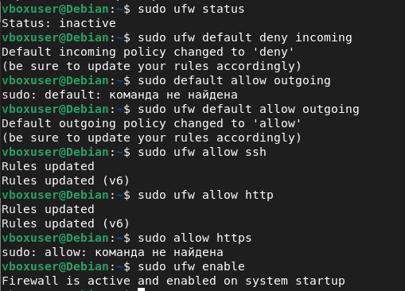

### 1.3 Проверка через `ufw status`

```bash
sudo ufw status verbose
sudo ufw status numbered
```

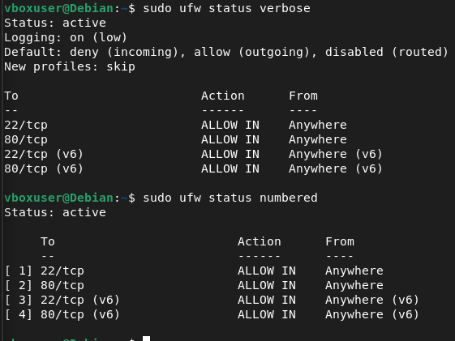

### 1.4 Проверка через `iptables`

UFW хранит правила в цепочках `ufw-*` (например, `ufw-user-input`). Политика цепочек `INPUT` и `FORWARD` — `DROP`, то есть всё неразрешённое отбрасывается.

```bash
sudo iptables -L -n -v
```

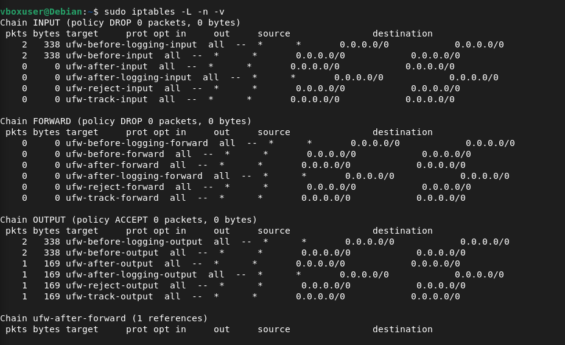

---

## 2. Безопасность системы

### 2.1 Автоматические обновления безопасности

**Теория.** Большинство взломов используют известные уязвимости в непропатченном ПО. Пакет **unattended-upgrades** автоматически устанавливает обновления безопасности без участия администратора. Запуск обеспечивают systemd-таймеры `apt-daily.timer` (обновление списков пакетов) и `apt-daily-upgrade.timer` (установка обновлений).

| Файл / команда | Назначение |
|---|---|
| `/etc/apt/apt.conf.d/20auto-upgrades` | включает периодическое обновление списков и установку пакетов |
| `/etc/apt/apt.conf.d/50unattended-upgrades` | указывает, из каких репозиториев ставить обновления (security) |
| `dpkg-reconfigure -plow unattended-upgrades` | включает автообновления через диалог |
| `systemctl status unattended-upgrades` | состояние службы |
| `systemctl list-timers \| grep apt` | расписание таймеров APT |

```bash
sudo apt install -y unattended-upgrades apt-listchanges
sudo dpkg-reconfigure -plow unattended-upgrades
systemctl status unattended-upgrades --no-pager
systemctl list-timers | grep apt
```

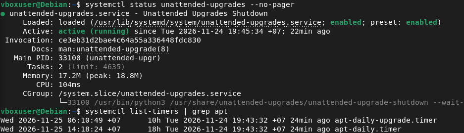

### 2.2 Защита от брутфорса: Fail2ban

**Теория.** Брутфорс — подбор пароля перебором. **Fail2ban** читает логи служб (здесь — журнал systemd для `sshd`), считает неудачные попытки входа и при превышении лимита временно блокирует IP-адрес правилом файрвола. Основной конфиг `jail.conf` не редактируют: свои настройки пишут в `jail.local`, он имеет приоритет и не затирается при обновлении.

| Параметр | Значение | Смысл |
|---|---|---|
| `bantime` | `1h` | на сколько банится адрес |
| `findtime` | `10m` | окно времени, в котором считаются попытки |
| `maxretry` | `3` | допустимое число неудачных попыток |
| `ignoreip` | `127.0.0.1/8 ::1` | адреса, которые не банятся |
| `[sshd] enabled` | `true` | включает защиту SSH |
| `backend` | `systemd` | источник логов — журнал systemd |

| Команда | Что делает |
|---|---|
| `apt install fail2ban` | установка |
| `systemctl enable --now fail2ban` | запуск и автозапуск службы |
| `fail2ban-client status` | список активных «тюрем» (jail) |
| `fail2ban-client status sshd` | счётчики и список забаненных IP для `sshd` |
| `fail2ban-client set sshd unbanip <IP>` | снять бан вручную |

```bash
sudo apt install -y fail2ban
sudo systemctl enable --now fail2ban
systemctl status fail2ban
```

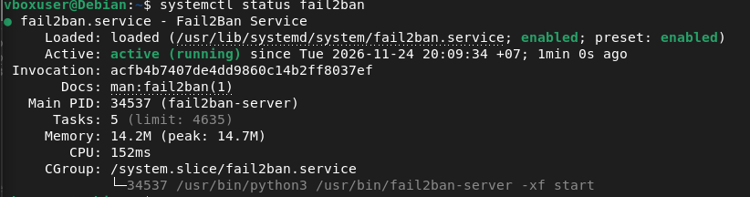

Конфигурация `/etc/fail2ban/jail.local`:

```ini
[DEFAULT]
bantime  = 1h
findtime = 10m
maxretry = 3
ignoreip = 127.0.0.1/8 ::1

[sshd]
enabled = true
port    = ssh
backend = systemd
```

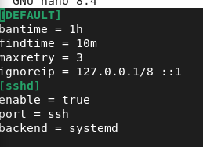

```bash
sudo systemctl restart fail2ban
sudo fail2ban-client status
sudo fail2ban-client status sshd
```

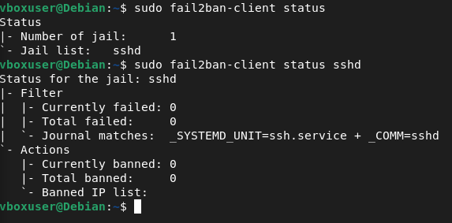

Лог `/var/log/fail2ban.log` подтверждает применение параметров (`maxRetry: 3`, `findTime: 600`, `banTime: 3600`):

```bash
sudo tail -n 20 /var/log/fail2ban.log
```

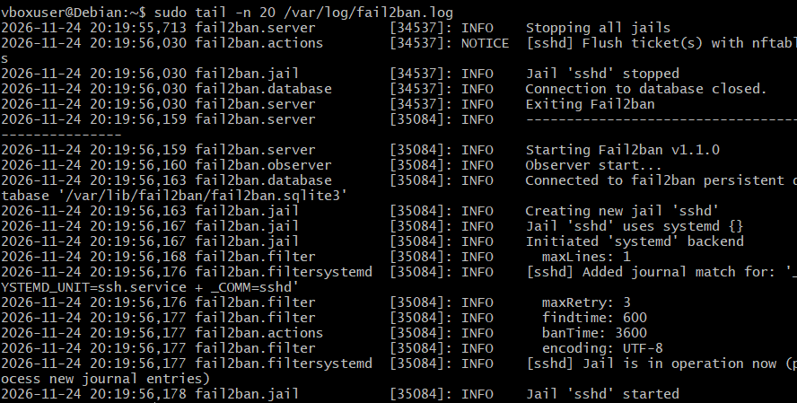

---

## 3. Управление файловыми системами

**Теория.** Чтобы использовать новый диск, нужно пройти цепочку: **диск → раздел → файловая система → монтирование**.

- **Раздел** — логическая часть диска, создаётся таблицей разделов (`fdisk`, формат MBR/DOS).
- **ext4** — журналируемая файловая система Linux: журнал защищает данные при внезапном отключении питания.
- **Монтирование** — присоединение ФС к дереву каталогов (точка монтирования `/mnt/storage`).
- **`/etc/fstab`** — таблица автомонтирования при загрузке.

| Команда | Что делает |
|---|---|
| `lsblk` | дерево блочных устройств (диски, разделы, точки монтирования) |
| `fdisk -l` | таблицы разделов всех дисков |
| `fdisk /dev/sdb` | интерактивное разбиение диска |
| `mkfs.ext4 /dev/sdb1` | создаёт файловую систему ext4 на разделе |
| `mkdir -p /mnt/storage` | создаёт точку монтирования |
| `mount /dev/sdb1 /mnt/storage` | монтирует раздел вручную |
| `df -hT` | занятое место и тип ФС в читаемом виде |
| `blkid` | показывает UUID разделов |
| `mount -a` | монтирует всё, что описано в fstab (проверка записи) |
| `findmnt --verify` | проверяет корректность fstab |

### 3.1 Подключение виртуального диска

В настройках VirtualBox (Носители → Контроллер SATA) добавлен второй виртуальный диск `Debian_1.vdi` (~130 МБ).

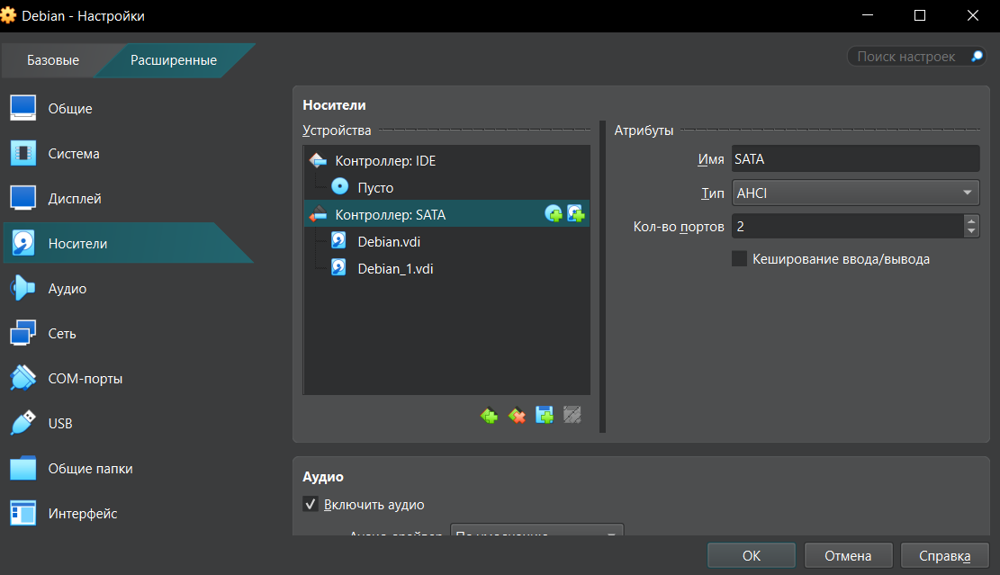

Система видит новый диск `/dev/sdb` без таблицы разделов:

```bash
sudo fdisk -l
```

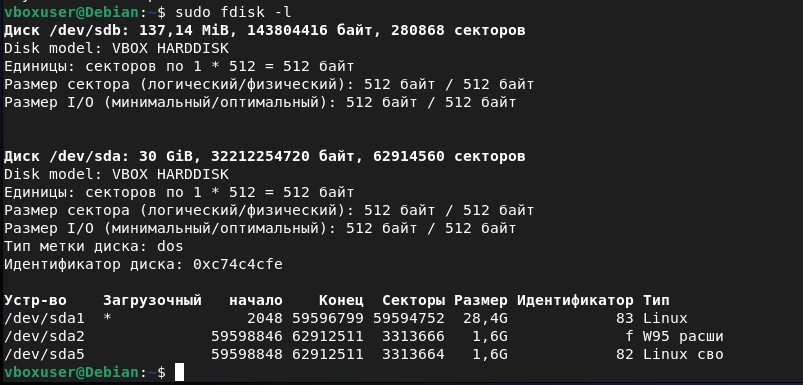

### 3.2 Создание раздела

В `fdisk`: `n` (новый раздел) → `p` (primary) → `1` (номер) → Enter, Enter (границы по умолчанию) → `w` (записать таблицу).

```bash
sudo fdisk /dev/sdb
```

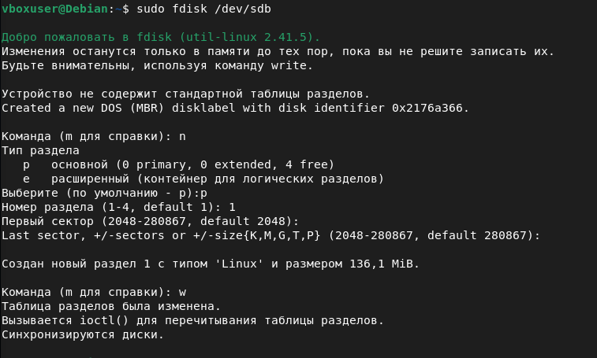

```bash
lsblk
```

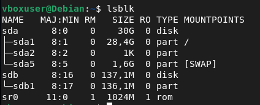

### 3.3 Форматирование в ext4 и монтирование

```bash
sudo mkfs.ext4 /dev/sdb1
sudo mkdir -p /mnt/storage
sudo mount /dev/sdb1 /mnt/storage
df -hT /mnt/storage
```

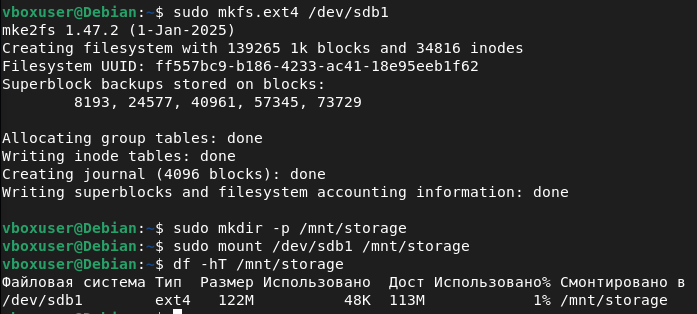

### 3.4 Автомонтирование при загрузке

Для записи в fstab используется **UUID**, а не имя `/dev/sdb1`: имена устройств могут меняться, UUID постоянен.

```bash
sudo blkid /dev/sdb1
sudo nano /etc/fstab
```

Добавленная строка:

```
UUID=ff557bc9-b186-4233-ac41-18e95eeb1f62  /mnt/storage  ext4  defaults,nofail  0  2
```

| Поле | Значение | Смысл |
|---|---|---|
| 1 | `UUID=...` | какой раздел монтировать |
| 2 | `/mnt/storage` | куда монтировать |
| 3 | `ext4` | тип ФС |
| 4 | `defaults,nofail` | стандартные опции; `nofail` — не останавливать загрузку, если диска нет |
| 5 | `0` | резервное копирование `dump` не используется |
| 6 | `2` | порядок проверки ФС при загрузке (после корневой) |

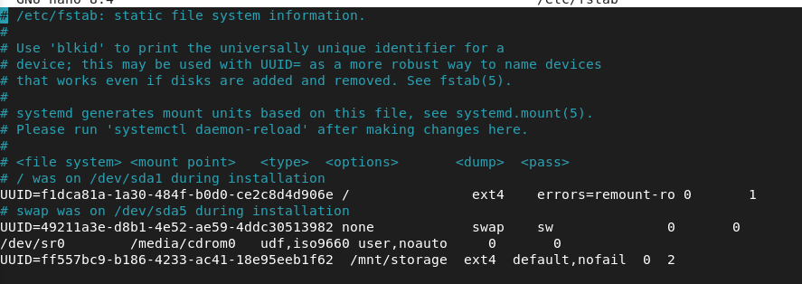

Проверка записи без перезагрузки:

```bash
sudo systemctl daemon-reload
sudo umount /mnt/storage
sudo mount -a
findmnt --verify
findmnt /mnt/storage
```

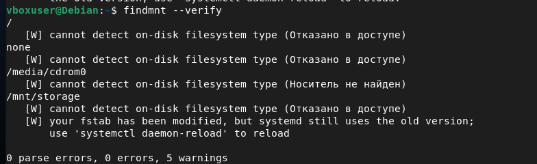

Проверка после перезагрузки (`sudo reboot`):

```bash
df -h | grep storage
lsblk
```

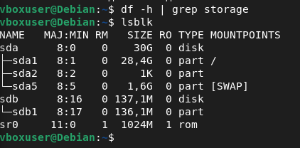

---

## 4. Мониторинг дискового пространства

### 4.1 Анализ использования диска

| Команда | Что делает |
|---|---|
| `df -h` | свободное/занятое место по смонтированным ФС (`-h` — человекочитаемые единицы) |
| `df -hT` | то же + тип файловой системы |
| `df -i` | использование inode (число файлов); ФС может «кончиться» по inode раньше, чем по месту |
| `lsblk -f` | устройства + тип ФС, UUID, свободное место и точка монтирования |
| `fdisk -l /dev/sdb` | разделы конкретного диска, размер и тип |
| `du -sh <каталог>` | суммарный размер каталога |
| `du -ah /var \| sort -rh \| head -10` | топ-10 самых больших файлов и каталогов (`-a` все файлы, `sort -rh` сортировка по размеру) |

```bash
df -h
df -hT
df -i
```

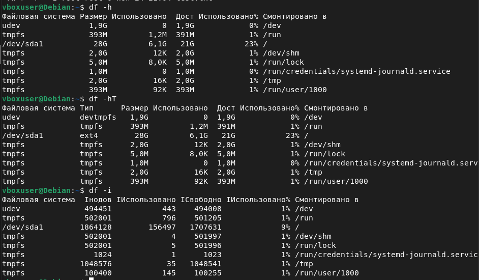

```bash
lsblk -f
```

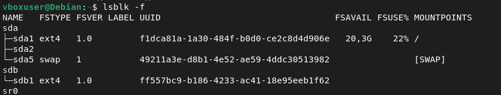

```bash
sudo fdisk -l /dev/sdb
```

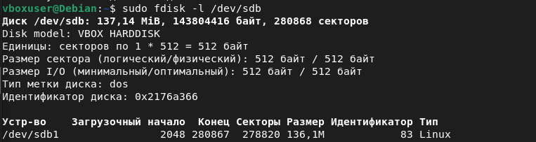

```bash
sudo du -ah /var 2>/dev/null | sort -rh | head -10
```

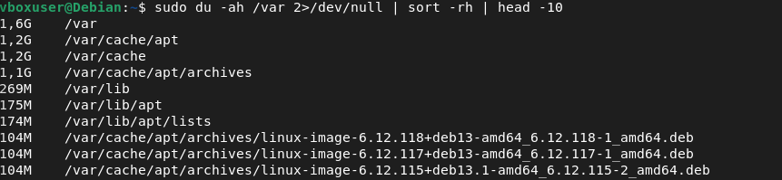

### 4.2 Скрипт оповещения при заполнении ≥ 80 %

**Принцип работы:** для каждой точки монтирования скрипт получает процент использования из `df`, сравнивает с порогом и при превышении пишет сообщение в лог, в системный журнал и всем пользователям в терминал.

| Элемент скрипта | Назначение |
|---|---|
| `df --output=pcent "$MP"` | выводит только колонку «Use%» |
| `tail -n 1` | отбрасывает строку заголовка |
| `tr -dc '0-9'` | оставляет только цифры (убирает знак `%`) |
| `[ "$USAGE" -ge "$THRESHOLD" ]` | сравнение: использовано ≥ порога |
| `logger -p user.warning -t disk_alert` | запись в системный журнал (`journalctl -t disk_alert`) |
| `wall` | рассылка сообщения всем залогиненным пользователям |

`/usr/local/bin/disk_alert.sh`:

```bash
#!/bin/bash
THRESHOLD=80
LOGFILE=/var/log/disk_alert.log
MOUNTS="/ /mnt/storage"

for MP in $MOUNTS; do
    USAGE=$(df --output=pcent "$MP" | tail -n 1 | tr -dc '0-9')
    if [ "$USAGE" -ge "$THRESHOLD" ]; then
        MSG="$(date '+%F %T') WARNING: partition $MP filled to ${USAGE}%"
        echo "$MSG" >> "$LOGFILE"
        logger -p user.warning -t disk_alert "$MSG"
        echo "$MSG" | wall 2>/dev/null
    fi
done
```

```bash
sudo chmod +x /usr/local/bin/disk_alert.sh
bash -n /usr/local/bin/disk_alert.sh
```

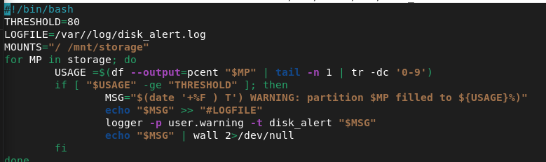

### 4.3 Автозапуск через cron

**Cron** — планировщик задач. Формат записи: `минута час день_месяца месяц день_недели команда`. Запись `* * * * *` запускает скрипт каждую минуту (для демонстрации; в реальной работе обычно `*/30 * * * *` или раз в час).

```bash
sudo crontab -e
```

```
* * * * * /usr/local/bin/disk_alert.sh
```

```bash
sudo crontab -l
```

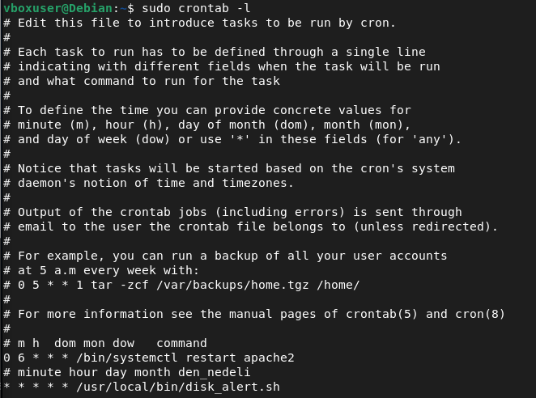

### 4.4 Проверка срабатывания

Диск `/mnt/storage` (~122 МБ) заполняется файлом 110 МБ. `fallocate` мгновенно выделяет место под файл без записи данных.

```bash
df -h /mnt/storage
sudo fallocate -l 110M /mnt/storage/bigfile.bin
df -h /mnt/storage
```

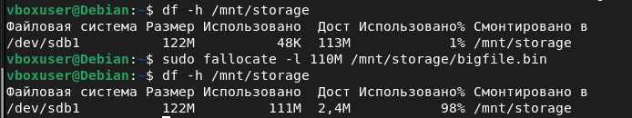

Через минуту cron запускает скрипт, и в логе появляется предупреждение:

```bash
cat /var/log/disk_alert.log
```

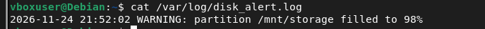

Очистка после теста:

```bash
sudo rm /mnt/storage/bigfile.bin
df -h /mnt/storage
```

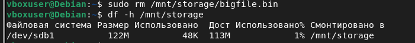

---

## 5. Вывод

В ходе работы настроен файрвол UFW (запрещён весь входящий трафик, кроме SSH, HTTP и HTTPS), включены автоматические обновления безопасности и защита SSH от перебора паролей с помощью Fail2ban. Новый виртуальный диск разбит на разделы, отформатирован в ext4 и подключён к `/mnt/storage` с автомонтированием через `/etc/fstab`. Для контроля свободного места использованы `df`, `du`, `lsblk`, `fdisk`, а скрипт с cron оповещает о заполнении раздела выше 80 %.
